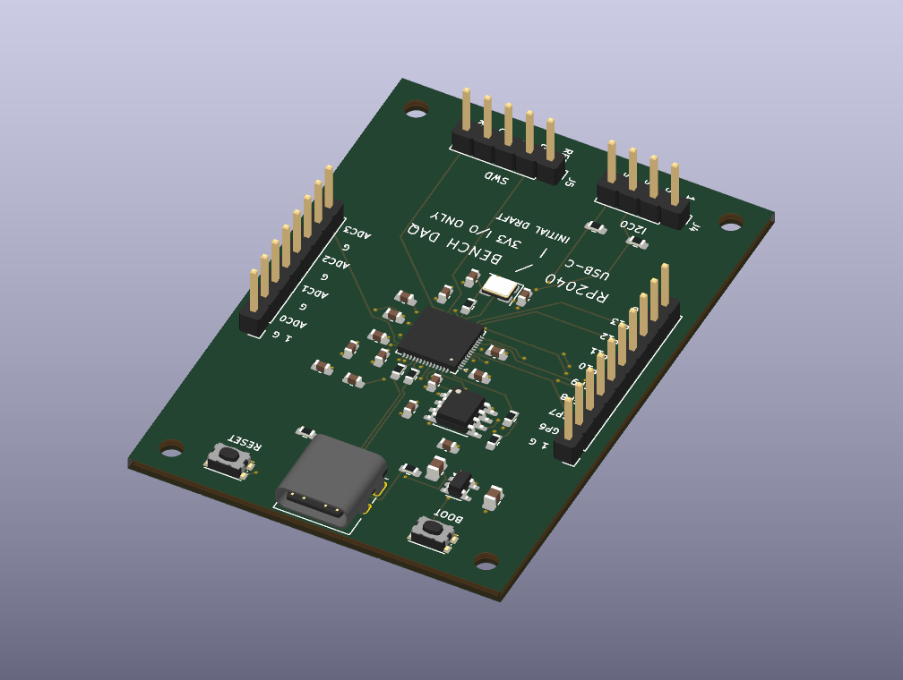

[Download this editable project ZIP](rp2040-usb-controller.zip)

Extract the complete project folder before opening it. The source files are also available below.

ZIP SHA-256: `ee8aa9aada79eca28375414765a2e70979933c8f12b47b56a6a397c69c7f46b1`

# RP2040 USB-C Bench DAQ / Controller

An editable, USB-powered RP2040 bench design with four analogue inputs, eight digital I/O, I2C and SWD. The design starts with the leads: each analogue input on J2 has its ground beside it. The USB-C receptacle sits on a short edge; digital and analogue headers are on opposite sides of the board.



## Open and inspect

Extract the entire directory together. Open **rp2040-usb-controller.kicad_pro** in TraceForge or KiCad 10.0.5 with the standard KiCad 10 symbols and footprints installed. Open the schematic to follow a channel, then open the PCB to inspect the copper. In the PCB editor choose **View → 3D Viewer** (Alt+3). The supplied render uses the exact STEP resources named in the board; it is not a photograph.

With the matching stock 3D libraries installed, the standard paths work. To use just this package’s fourteen models on Linux without changing your global path, start a single KiCad session from this directory:

```sh
KICAD10_3DMODEL_DIR="$PWD/models" kicad rp2040-usb-controller.kicad_pro
```

On Windows, open a fresh PowerShell in the extracted directory, set `$env:KICAD10_3DMODEL_DIR = (Resolve-Path .\models).Path`, and start your installed KiCad executable from that shell with the .kicad_pro file. Closing that shell leaves the normal system setting unchanged.

## At the bench

**This is an unbuilt design reference**, not a tested device. See [the design notes and numbered header guide](PROJECT.md) for signal limits and intended use; [Bench-BOM.csv](Bench-BOM.csv) is editable. There is no firmware. Do not backfeed the 3V3 output or assume protection for inputs outside the specified range. Perform your own fabrication, electrical, fit and bring-up reviews.

## What the checks cover

The supplied PCB and schematic were read with KiCad 10.0.5. Enabled ERC, DRC and schematic-to-board parity reported no findings; the DRC report recorded no unconnected items. All 42 footprint origins, including four mounting holes, were inside the rectangular board outline. The 38 fitted references use the fourteen unique STEP models supplied here. This post-run visual check supplements the original engineering notes: the creator sandbox did not itself contain the model library.

The native full candidate suite reported **14 passed, 0 failed, 9 skipped**. [The suite summary](checks/agent-checks.json) names each check. The KiCad reports preserve their ignored-check lists: [ERC](checks/erc.json) and [DRC and parity](checks/drc-parity.json). No hardware performance, impedance measurement, enclosure mating tolerance or USB certification is claimed.

[Licence and attribution](ATTRIBUTION.md) · [TraceForge app download](https://traceforge.space/download/)
